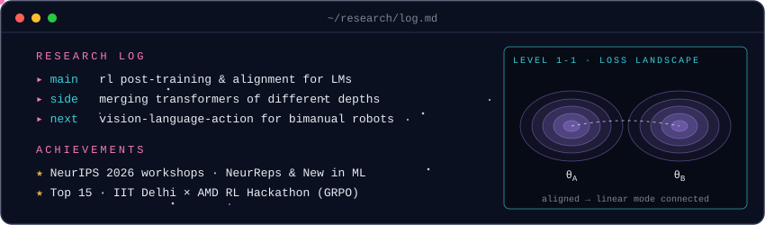
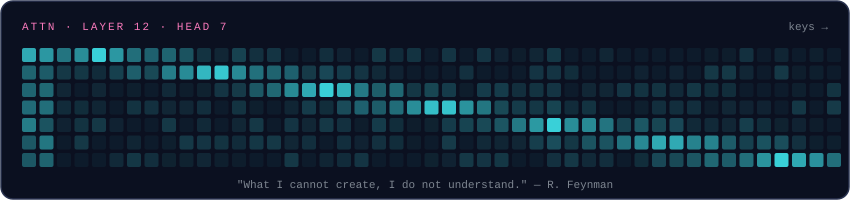

  

  
  
  

  

### 📄 Publications

**Symmetry Alignment Across Depth in Transformer Merging** 
Krish Malik, **Tasmayu Swain**, Krishna Mudgal · <i>NeurIPS 2026 Workshops: NeurReps & New in ML</i> 
Identity-padding based symmetry alignment for merging Transformers of <b>different depths</b>, and when generalized symmetry alignment breaks under depth heterogeneity.

**How Far Does Generalized Symmetry Alignment Reach? Reproducing and Extending Linear Mode Connectivity for Transformers** 
**Tasmayu Swain**, Krish Malik, Krishna Mudgal, Yajat Makhija · <i>OpenReview</i> 
Reproducing and extending Generalized LMC for ViTs and GPT-2 across out-of-domain code, varying depths, regularized weight matching and adversarial endpoints.

### 🧪 Research Projects

| | Project | What it does |
|---|---|---|
| 🎯 | [**SWARL**](https://github.com/TASMAYU/SWARL) | RL post-training & alignment library for language models |
| 🧠 | [**RL & Internal Errors**](https://github.com/TASMAYU/Does-RL-improve-its-access-to-its-own-Internal-Errors-) | Does RL make small LMs actually notice their own reasoning errors? |
| 🦾 | [**Bimanual VLA · SO-101**](https://github.com/TASMAYU/BI_MANUAL_VLA_SO101) | Two robot arms in MuJoCo set a dinner table from language + multi-view vision |
| ⚛️ | [**LM-JEPA for Squared Amplitudes**](https://github.com/TASMAYU/Foundation-Models-for-Squared-Amplitude-Calculation) | JEPA framework for particle-physics squared amplitudes |

### 🛠️ Rebuilt from Scratch

| | Paper | Inside |
|---|---|---|
| 🐋 | [**DeepSeek-V3**](https://github.com/TASMAYU/DEEPSEEK-V3-_FROM_SCRATCH) | MLA · fine-grained MoE routing · load balancing · multi-token prediction |
| 🌫️ | [**Nano Diffusion LM**](https://github.com/TASMAYU/NANO_DIFFUSION_LANGUAGE_MODEL) | LLaDA-style masked diffusion with a ModernBERT mask predictor |
| 🪆 | [**HOPE · Nested Learning**](https://github.com/TASMAYU/HOPE_NL_CMS) | HOPE architecture + Continuum Memory System optimizer |
| 🌀 | [**JEPA Double Pendulum**](https://github.com/TASMAYU/bu1ld-jepa-double-pendulum) | JEPA world model on chaotic dynamics |

  

